# Всем привет 👋

Я разработчик с опытом развёртывания и сопровождения серверной инфраструктуры. Развиваюсь в сторону SRE/DevOps: мониторинг, разбор инцидентов, автоматизация рутины и надёжность сервисов.

- Занимаюсь поддержкой Linux-серверов и сервисов, настраиваю мониторинг и алерты.
- Автоматизирую сбор данных и ML-пайплайны: Python, Docker, DVC, MLflow, CI/CD в GitHub Actions.
- Интересуюсь робототехникой, CV и ML и применяю их в реальных задачах.

## 💻 Мои проекты

| Проект | Описание |
| --- | --- |
| [Система мониторинга парка 3D-принтеров](https://github.com/Pozovi23/PrintWatch) | Развернул стек мониторинга на Prometheus, Grafana и Alertmanager в Docker. Написал на Python кастомный Prometheus-экспортёр для опроса API принтеров с прошивкой Klipper и сбора метрик: температуры, прогресс печати. Настроил алерты и оповещения в Telegram через Alertmanager при сбоях печати, перегреве или отключении оборудования. Собрал интерактивный дашборд в Grafana. Настроил CI/CD в GitHub Actions: unit-тесты, линтинг и проверка сборки Docker-образов при открытии MR. |
| [Обнаружение утечек трубопроводов](https://vk.ru/wall-195770864_708) | Принимал участие в создании ПО, которое анализирует данные с оптоволоконных систем мониторинга и в реальном времени детектирует температурные аномалии, что позволяет обнаружить утечки жидкости. Отвечал за серверную часть инфраструктуры: автоматическую отправку данных с удалённых объектов на сервер для тренировки ML-модели и развёртывание Telegram-ботов для автоматизации мониторинга объектов. Разработано совместно с компанией ООО «СибСенсор», продемонстрировано на реальных объектах на форуме «Прибориум 2026». |
| [ROS2 AutoRace](https://github.com/Pozovi23/my_robot) | Реализация функционала робота в ROS2 для прохождения модернизированной трассы испытаний AutoRace 2025. |
| [Автоматизированный мини-ПВЗ](https://github.com/Pozovi23/Pick-up-point-automation) | Создание конвейерной системы и робота-кладовщика для прототипа автоматизации пункта выдачи заказов.  [▶ видео с демонстрацией](https://youtu.be/E9XQAeJRJnU?si=D68Upd1gI2q3Ge20) |
| [Детекция людей с дронов](https://github.com/Pozovi23/People-detection-from-drone) | В основе лежит YOLOv8. Проводились эксперименты с оптимизацией времени инференса на CPU (фреймворк OpenVINO) и GPU (SAHI). Лучший результат по метрике mAP50 = **0.724**. |
| [Сегментация дорог](https://github.com/Pozovi23/Segmentation) | В основе лежит U-Net (бэкбон ResNet34), дообученная для использования на датасете Massachusetts Roads. IoU = **0.516**. |

## 🔧 Технологический стек

<picture>
  <source
    media="(prefers-color-scheme: dark)"
    srcset="https://raw.githubusercontent.com/Pozovi23/Pozovi23/main/dino-dark.svg"
  />
  <source
    media="(prefers-color-scheme: light)"
    srcset="https://raw.githubusercontent.com/Pozovi23/Pozovi23/main/dino.svg"
  />
  
</picture>
